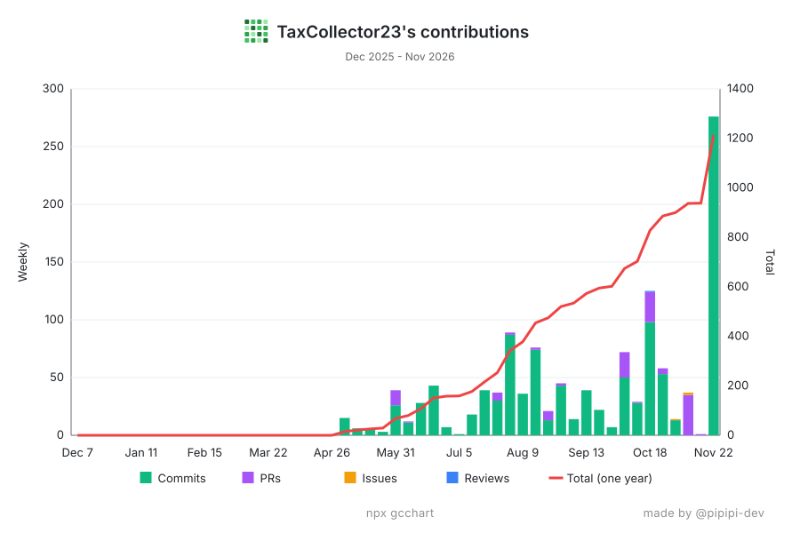

# Hey, I'm Rangan.

I'm a student and software developer interested in agentic development, artificial intelligence, and open-source software. I spend a lot of my time experimenting with new technologies, building projects, and learning how LLMs and other systems work.

I'm also the co-founder of [**Aule Labs**](https://github.com/Aule-Labs), an independent AI research lab run by my friend and I, where we experiment with AI systems.
## Some of my Projects

- [**AfterCare**](https://github.com/VedChiFrendoflake/AfterCare) - An AI-powered application that helps patients understand hospital discharge instructions and organize their recovery.
- [**Sharely**](https://github.com/TaxCollector23/sharely) - A lightweight CLI for sharing files, folders, and locally hosted websites over a network.
- [**OwnBot**](https://github.com/TaxCollector23/OwnBot) - A platform for running open-weight AI agents locally with tool integrations and remote task management.
- [**TransitGap**](https://github.com/TaxCollector23/transitgap) - An open-source routing application that accounts for accessibility barriers when navigating to public transit stops.

I have many other significant projects, but these are the most presentable.

## Outside of Development

In my free time, I enjoy playing cricket, the guitar, and quizbowl.

I'm always open to collaborating or connecting :)

https://rangan.xyz

Feel free to reach out on any of my socials.&#x20;

## Contributions

